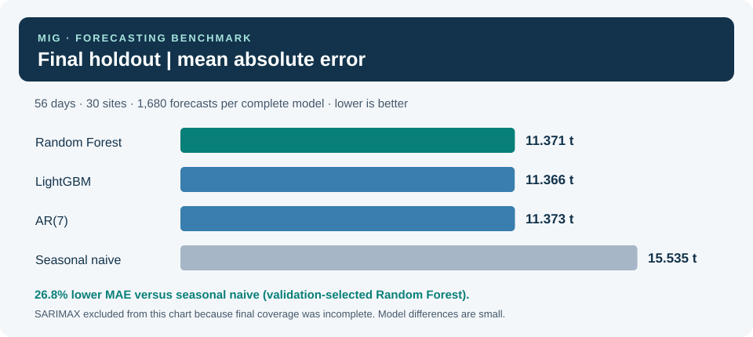

# MIG Cement Demand Forecasting & Inventory Optimisation

**Multi-site supply chain analytics and predictive decision support**

I developed this case study around the problem of matching cement supply to construction activity across a distributed site network. The original group assignment compared autoregression, SARIMAX and LightGBM; Random Forest was explored in a subsequent drop-in session. This portfolio edition rebuilds that comparison on a common eight-week forecasting protocol and connects the forecasts to a replenishment policy replay.

## Start here: one business-first notebook

The primary walkthrough is **[Cement_demand_forecasting.ipynb](Cement_demand_forecasting.ipynb)**. I consolidated the operational analysis and planned-pour experiments into the existing notebook, preserving that filename and retaining earlier revisions in Git history. This notebook now follows the decision sequence **business problem → source integrity → operational constraints → forecast-time information → conditional model experiments → hypothetical replenishment replay → local dashboard**.

The notebook contains source code and Markdown explanations but deliberately **no executed outputs**. It must be rerun with the authorised local database before its new scenario results can be verified. The published results in [docs/results.md](docs/results.md) are **earlier executed benchmarks**, not evidence that the new notebook has passed a fresh end-to-end run.

For the interpretation of stock availability, planned demand, capacity limits, forecast leakage and remaining evidence requirements, read the [operational decision framework](docs/operational_decision_framework.md). The existing `forecast.py`, `inventory.py`, `diagnose.py`, `app.py` and `test_workflow.py` remain available as previously developed supporting scripts; the notebook does not depend on them to execute its own experiments.

## Business problem

Uncertain pour schedules, weather and site-level consumption create a difficult trade-off between having enough cement for scheduled work and holding excessive inventory. The objective is to give planners an evidence-based view of future consumption, storage constraints and potential replenishment needs.

| Case-study objective | Target | Evidence |
| --- | --- | --- |
| Daily site-level forecast accuracy | MAPE ≤ 15% over 56 days | Nonzero-day MAPE alongside MAE, RMSE, WAPE and bias |
| Pour readiness | ≥ 98% | Simulated scheduled-day stock availability |
| Inventory efficiency | ≥ 20% improvement | Capacity utilisation and stock levels under comparable policies; direction and baseline must be agreed |
| Write-offs | ≥ 30% reduction | Not measurable without expiry, disposal and write-off records |
| Decision visibility | Plotly Dash | Three local dashboard views |

## Data and privacy

The source is a restricted SQLite database with three related tables: `Operations`, `Sites` and `CementTypes`. I checked integrity, foreign keys, completeness, site-date uniqueness, capacity consistency and inventory arithmetic. Historical overcapacity is retained as a data-quality and operational signal, not silently clipped.

The database, case-study document, site-level forecasts, inventory traces, credentials and trained models are deliberately excluded from this repository. Only network-wide aggregate results are published. The database is required to reproduce the analysis and must be obtained through an authorised source. Do not upload your local outputs or notebook outputs containing individual site records.

## Methodology

1. Validate daily site records and retain the observed consumption target.
2. Create strictly historical lags and rolling statistics at each forecast issue date.
3. Compare seasonal-naive, AR(7), SARIMAX, Random Forest and LightGBM over three disjoint 56-day windows, refitting on preceding observations only. The first two windows support model selection; the last is the final holdout.
4. Use MAE as the selection criterion; assess WAPE, RMSE, bias and nonzero-day MAPE. Exclude incomplete model coverage from the selection pool. Zero-consumption days remain in MAE, RMSE and WAPE.
5. Replay inventory with a two-day delivery lead time, capacity-aware orders and explicit outstanding deliveries. Select buffer days on validation, then compare seasonal-naive and selected-model policies on the final window. Excess starting stock is explicitly segregated in a capacity-feasible scenario; it is not assumed to be discarded. The inventory scenario is exploratory because it was revised after inspecting the initial replay.
6. Present historical replay results in a local Dash application.

Actual future weather, deliveries, closing inventory and realised consumption are never provided to the forecasting models. Planned-pour snapshots as known at each issue date are not available; historical planned pours are used as lagged signals rather than assuming perfect future schedule knowledge. Site capacity and behavioural labels are treated as static metadata known at issue time.

## Results

Random Forest narrowly led the validation comparison on MAE. On the final holdout it reduced MAE by 26.8% relative to the seasonal-naive baseline, but LightGBM and AR were practically tied with it. The 15% forecast MAPE and 98% simulated readiness targets were not met. See [model and inventory results](docs/results.md) for the full benchmark, coverage and target assessment.

The [mathematical diagnostic analysis](docs/diagnostic_analysis.md) investigates why the forecast target remains unmet. It separates uncertainty in planned pours, weather and supply availability from legitimate forecast-time inputs. A hindsight result is not counted as prospective forecast performance.



### Run the consolidated notebook

Place your **authorised** `MIG_Cement_Records.db` beside `Cement_demand_forecasting.ipynb`, install the dependencies from this repository and open the notebook in your preferred local Jupyter application. Run cells in order, reviewing the operational audit **before** forecasting. The notebook requires additional estimators (XGBoost and CatBoost) for its later exploratory comparisons. The optional Plotly Dash preview is launched manually; it is bound to `127.0.0.1` and must never be exposed publicly with restricted site records.

The 56-day plan-conditional and realised-weather results are **retrospective information scenarios**, not deployable predictions. Do not interpret a provisional replay as achieved savings or procurement instructions. If database units, capacity or plan issue dates remain unresolved, stop at the corresponding decision gate instead of treating the numerical output as validated.

## Run locally

Python 3.12 was used for the portfolio benchmark. From the repository root:

```bash
python -m venv .venv
source .venv/bin/activate
python -m pip install -r requirements.txt
python forecast.py /path/to/authorised/MIG_Cement_Records.db
python inventory.py /path/to/authorised/MIG_Cement_Records.db
python app.py
```

Open `http://127.0.0.1:8050`. The dashboard is local-only; do not expose it publicly with restricted outputs. The notebook provides an annotated equivalent workflow. For Windows, activate with `.venv\Scripts\activate`.

## Repository guide

| File | Purpose |
| --- | --- |
| `Cement_demand_forecasting.ipynb` | One business-first, independently explained notebook (unexecuted working revision on this branch) |
| `forecast.py` | Data checks, feature engineering and fair model competition |
| `inventory.py` | Replenishment policy simulation and summary |
| `app.py` | Executive, forecasting and inventory views |
| `docs/results.md` | Prior executed aggregate benchmark and limitations |
| `docs/operational_decision_framework.md` | Physical constraints, decision timing, policy conditions and evidence gates |
| `diagnose.py` | Aggregate physical constraint and conditional information experiments |
| `docs/diagnostic_analysis.md` | Mathematical diagnosis and next steps against the original targets |
| `requirements.txt` | Python dependencies |
| `test_workflow.py` | Synthetic leakage, metric and mass-balance tests |
| `.gitignore` | Local data and generated-output exclusions |

## Limitations

Observed consumption can be lower than true demand when supplies constrain work. The stock replay therefore uses recorded consumption, not an estimate of unmet demand. Pour readiness compares available stock to scheduled tonnes, rather than claiming an observed cancellation or completion outcome. No savings, write-offs or carbon reductions are inferred without supporting records. Delivery lead time and buffer are scenario assumptions, not measured service commitments. The unusually large historical overcapacity values require source reconciliation; the replay assumes any opening stock above capacity can be held elsewhere, which must be validated operationally. The historical replay is not a live deployment.

**Author:** Oluwadamilare Akinwumi Tijani · [GitHub](https://github.com/DareTJ)
